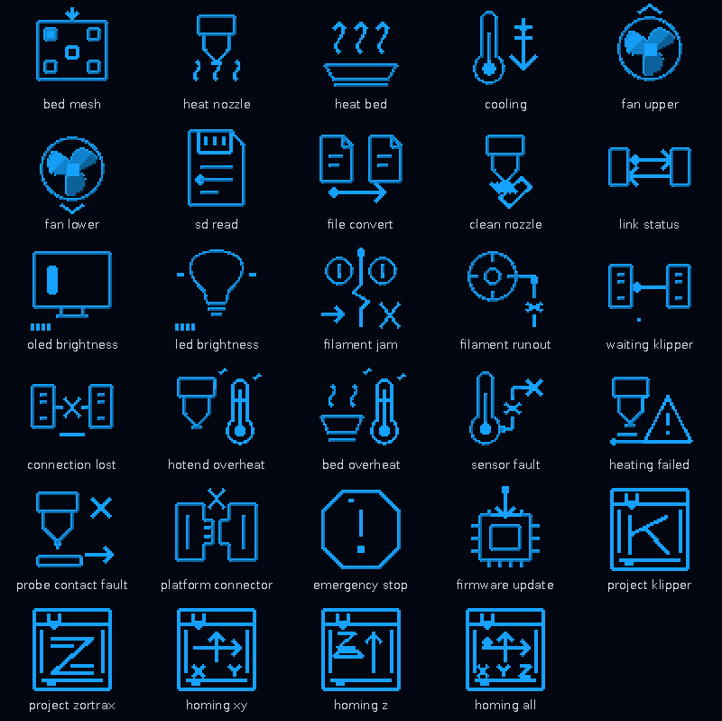

# Inventure R36 · OLED configuration and project animations

The R36 Orange Pi host pairs with **RC8-CONTROL-R7-DISPLAY-R14**. Owners who already have MCU R14 can install this release entirely on the Orange Pi.

## Install

With the printer idle, run these commands in the Orange Pi shell.

```bash
git -C "$HOME/inventure-orange-pi" fetch origin tag inventure-display-r36 &&
git -C "$HOME/inventure-orange-pi" worktree add --detach "$HOME/inventure-display-r36" refs/tags/inventure-display-r36 &&
python3 "$HOME/inventure-display-r36/install-orange-pi.py" --configure-fluidd --organize-config
```

If the checkout already exists at this tag, run the last line directly. Add `--check` to preview the changes. After the installer restarts the services, reload Fluidd and run the following in its console.

```gcode
INVENTURE_VERSION
INVENTURE_OLED_ICONS NAME=heat_nozzle
```

The host revision is `RC8-CONTROL-R7-DISPLAY-R36`. The gallery also opens under **Zortrax Inventure → Settings → OLED icons** on the physical panel. Use **Next**, **Previous** and **Back**. [Panel configuration and controls](https://github.com/MarcinKowalik-AGH/Zortrax-Inventure-Klipper/blob/inventure-display-r36/docs/Inventure_Display.md)

## Two independent dashboard warnings

| Finding | Repair |
|---|---|
| The R33.1 panel renderer loads Klipper's display status object internally. Fluidd 1.37.7 checks the active configuration for an explicit `[display_status]` or `[display]` section. | The dashboard installer adds the missing section. The organizer groups the physical Inventure driver, its preferences and display status in `inventure/display.cfg`. The old launcher name `m300` becomes `inventure` in the managed display file. Existing generic displays and site overrides are respected. |
| Moonraker registers the documentation root using the path reported by the running Klipper. The reduced Inventure source stage can lack its `docs` directory. | The installer creates the missing directory in that stage, supplies an Inventure display guide, and restarts the active Moonraker service to register the root. Existing documentation directories are retained. |

## Artwork for further development

The two runtime catalogs exactly match M300 v1.0.2 commit `67e300b8259886a7d5033c3e6c290d9e10012f32`. They also match its Orange Pi deployment. The Inventure renderer exposes the added assets under `project:`. Native r0323 menus, activity symbols, sleep and autonomous MCU fault pages retain their Inventure assignments. The host expands and caches the selected 4-bit animation frames and sends changes using the existing acknowledged display transport.

| Set | Editable sources | Installed catalog |
|---|---|---|
| 24 shaded activity and fault symbols, four frames each | [Native 4-bit frames and palette](https://github.com/MarcinKowalik-AGH/Zortrax-Inventure-Klipper/blob/inventure-display-r36/docs/assets/oled/project_activity_frames.json) | [Activity sprites](https://github.com/MarcinKowalik-AGH/Zortrax-Inventure-Klipper/blob/inventure-display-r36/orange_pi/inventure_project_activity_sprites.json) |
| Five two-tone project and homing animations, four frames each | [20 individual SVG frames](https://github.com/MarcinKowalik-AGH/Zortrax-Inventure-Klipper/tree/inventure-display-r36/docs/assets/oled/menu) | [Menu sprites](https://github.com/MarcinKowalik-AGH/Zortrax-Inventure-Klipper/blob/inventure-display-r36/orange_pi/inventure_project_menu_sprites.json) |



[M300 physical display configuration](https://github.com/MarcinKowalik-AGH/Zortrax-m300-Klipper/blob/67e300b8259886a7d5033c3e6c290d9e10012f32/host/config/m300_display.cfg) · [M300 base configuration](https://github.com/MarcinKowalik-AGH/Zortrax-m300-Klipper/blob/67e300b8259886a7d5033c3e6c290d9e10012f32/host/config/m300_classic_base.cfg#L195) · [Inventure thermal maps and local display firmware](https://github.com/MarcinKowalik-AGH/Zortrax-Inventure-Klipper/blob/inventure-display-r36/docs/INVENTURE_NATIVE_UI_R35.md)

## Validation

793 host tests passed locally. An upgrade from the published R33.1 modules was applied twice in a temporary Orange Pi stage, then rolled back to the original bytes. The release tests load field and fresh configurations in the pinned Klipper runtime, check `M117` and `M73`, exercise the real Moonraker file manager and verify repeat installations. Pixel tests compare all 116 project frames at the Inventure panel's actual pixel coordinates. The transport tests check host frames through Moonraker and the dashboard build runs in Chrome. The field log supplied for R33.1/R14 predates this host release. The appearance and navigation of R36 on the physical printer are pending operator verification.
