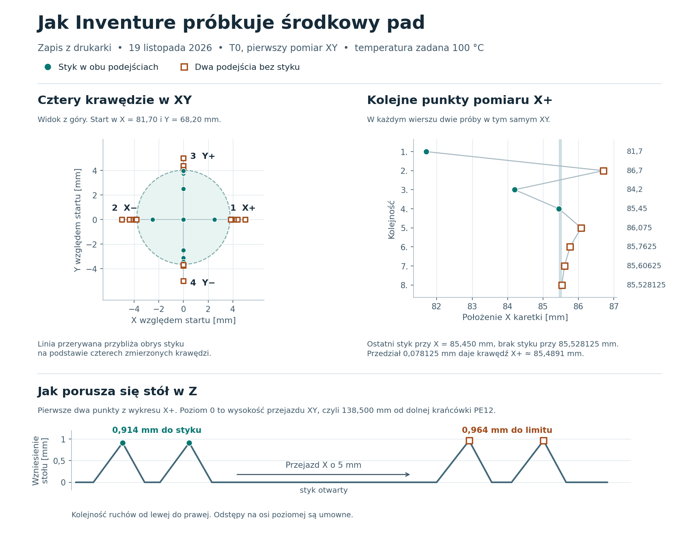

# Inventure — potwierdzenie pełnej kalibracji pada, 19.11.2026

Fizyczny przebieg **T0 → T1 → T0_RETURN zakończył się poprawnie**.
O 10:32:59 host zgłosił `phase=candidate` i `error=null`. O 10:39:05
potwierdził `phase=saved` dla tego samego przebiegu. To pierwsza zapisana próba serii.

Identyfikator: `6fa661efce2343d9be8f294437391a65`.
Pełny odczyt: [RESULT.json](INVENTURE_PAD_R23_2026-11-19_RESULT.json).

## Źródło i zakres

- Załącznik użytkownika: `klippy(16).log(1).zip`.
- SHA256 ZIP: `ed8d2a625721767c098b1a433cdf10f8f62b37dceed0103e79cc2349270bd879`.
- MCU jawnie rozpoznane w logu: `RC8-CONTROL-R7-PAD-THERMAL-R13-58ea5b576f76`.
- Wpisy pionowego TAP zawierają `latched_z_steps`, zgodnie z nową
  kwalifikacją R23. Log nie zawiera wyniku `INVENTURE_VERSION` z dokładnym
  identyfikatorem hosta. Wydanie R23 odpowiada commitowi
  `dc4d0f11398fcbfa8558714ba67a916883bee165`.
- Zakres próby obejmuje FULL, PREP=EMPTY, SCAN=SWEEP, temperaturę zadaną
  obu dysz 100°C i dopuszczalne pasmo 90–110°C. Host oznaczył każdy
  z trzech skanów jako SWEEP+TAP. Wszystkie 24 końcowe krawędzie
  wyznaczono dotknięciami pionowymi po odrzuconych startach ślizgu.
- Od startu procedury do końca parkowania minęło 2138,084 s (35 min 38 s).
  Pole `elapsed_s=2078.3` w starym raporcie liczy czas od rozpoczęcia grzania.

## Jak przebiegało próbkowanie pada



W każdym z trzech pomiarów (T0, T1, ponownie T0) host dwukrotnie wyznaczył
krawędzie w kolejności X+, X−, Y+, Y−. Na końcu dwa razy zmierzył wysokość
rozwarcia w wyznaczonym środku. Podczas pionowych prób TAP karetka zmieniała
punkt XY po opuszczeniu stołu i potwierdzeniu rozwarcia PC14.

Przy nastawie `Z_CLEARANCE_MM=1` poziom przejazdu T0 wynosił 138,500 mm od
dolnej krańcówki PE12. W pierwszym punkcie stół dojechał do styku po 733
krokach (0,914 mm), a przy pierwszej próbie T1 po 672 krokach (0,838 mm).
Poziom przejazdu jest liczony względem limitu Z danej dyszy. Dlatego rzeczywista
droga do styku zależy od punktu.

W pierwszym pomiarze T0 karetka odjechała poziomo o 5 mm od środka
startowego, po czym kolejne próby dzieliły przedział między stykiem i brakiem
styku na pół. Na X+ ostatni potwierdzony przedział wyniósł 0,078125 mm.
Przejazd od ostatniego punktu X+ do pierwszego punktu X− wyniósł 8,828125 mm
przy opuszczonym stole. Długi zjazd stołu w okolice dolnej krańcówki nastąpił
po całym skanie, przed zmianą narzędzia lub końcowym parkowaniem.

## Wyniki

| Wielkość | T0 | T1 | T0_RETURN |
|---|---:|---:|---:|
| Środek X [mm] | 81,700000 | 70,750000 | 81,700000 |
| Środek Y [mm] | 68,362500 | 68,7953125 | 68,362500 |
| Elektryczny wymiar X [mm] | 7,578125 | 7,49921875 | 7,578125 |
| Elektryczny wymiar Y [mm] | 7,64765625 | 7,57578125 | 7,64765625 |
| Powtarzalność dopasowania XY [mm] | 0,0328125 | 0,0171875 | 0,0328125 |
| Z rozwarcia od PE12 [mm] | 139,408977556 | 137,788029925 | 139,428927681 |
| Rozrzut dwóch próbek Z [mm] | 0 | 0 | 0 |

Wszystkie 24 potwierdzone przedziały krawędzi mają szerokość
0,075–0,0796875 mm. To potwierdza fizyczną próbę z dopuszczalnym
przedziałem 0,1 mm. Nie jest to potwierdzenie osiągnięcia 0,05 mm.

Sześć próbek Z zaakceptowano w pierwszych podejściach. Tam, gdzie było
potrzebne odzyskanie rozwarcia, wykonano 4 dodatkowe kroki w dół,
w istniejącym limicie. Zerowy rozrzut par oznacza zgodne liczniki kroków,
nie dowodzi zerowej niepewności pomiaru.

Powrót T0: X=0, Y=0, Z=+0,019950125 mm względem pierwszego pomiaru.
Z mieści się w kryterium 0,05 mm. Próbki temperatur zapisane przy
początkach trzech pomiarów mieszczą się w zakresie 94,4469–101,8608°C.

## Kandydat i konwencje znaków

| Pole kandydata | Wartość [mm] |
|---|---:|
| `t1_offset_mm.X` | +10,950000 |
| `t1_offset_mm.Y` | −0,432812 |
| `t1_carriage_shift_mm.X` | −10,950000 |
| `t1_carriage_shift_mm.Y` | +0,432812 |
| `t1_lower_by_mm` | +1,630923 |

Różnica Z wykorzystuje średnią pierwszego i powrotnego pomiaru T0:
`(139,408977556 + 139,428927681)/2 − 137,788029925 = 1,630922693 mm`.
Pola offsetu i przesunięcia karetki mają przeciwne znaki z definicji.

## Co pozostaje osobnym etapem

- Porównanie dwóch niezależnych przebiegów znajduje się poniżej. Kolejne
  próby poszerzą serię do oceny powtarzalności.
- PREP=EMPTY: wykonane kroki E dla T0 i T1 wynoszą zero. Ten przebieg
  nie jest testem gorącej retrakcji ani załadunku filamentu.
- Zapis nie stosuje automatycznie offsetu do natywnej zmiany narzędzia
  podczas druku; taka integracja pozostaje osobnym zadaniem.
- Dla 0,05 mm potrzebna jest osobna próba fizyczna. Nie jest wymagana
  do uznania zakończonej próby z przedziałem 0,1 mm.

Log zawiera również nieblokujący błąd wyjścia konsoli `os.write` /
`BlockingIOError` w trakcie nowej próby. Procedura kontynuowała pracę
i zakończyła się powodzeniem. Starsze komunikaty o utracie MCU należą
do wcześniejszej historii; nie są powodem zatrzymania tego przebiegu.

## Zapis zatwierdzonego wyniku

Konsola zarejestrowała kolejno polecenia:

```gcode
ZORTRAX_NOZZLE_PAD_CALIBRATE ACTION=SAVE RUN_ID=6fa661efce2343d9be8f294437391a65 ACK=PAD_RESULT_REVIEWED
ZORTRAX_NOZZLE_PAD_CALIBRATE ACTION=STATUS
```

Obie odpowiedzi z 10:39:05 zawierają `phase=saved` i ścieżkę
`/home/klipper/printer_data/config/inventure_nozzle_pad.json`. Wszystkie pomiary,
diagnostyka Z i wartości kandydata są identyczne z odczytem przed zapisem.
SHA256 załącznika `Wklejony tekst(20261119-093934).txt` wynosi
`4879ceb5a7a25d4c562c3f44fd5af30a93e7131c261f5b347dc90cf3e5df7ac0`.

## Drugi pełny przebieg

W pliku `klippy(17).log(1).zip` próba `4eed5e30be704a6ca57440e1e7f27b44`
zakończyła pomiary T0 → T1 → T0 i parkowanie po 35 min 22 s. Ostatni
status nowej próby to `candidate` z `error=null` i `saved_file=null`.
Status `saved` w tym pliku dotyczy pierwszej próby.
[Pełny wynik drugiej próby](INVENTURE_PAD_R23_2026-11-19_PROBA_2.json).

| Wynik [mm] | Próba 1 | Próba 2 | Zmiana (2 − 1) |
|---|---:|---:|---:|
| Offset T1 w X | +10,950000 | +10,950000 | 0,000000 |
| Offset T1 w Y | −0,432812 | −0,451562 | −0,018750 |
| O ile niżej jest T1 | 1,630923 | 1,635287 | +0,004364 |
| Z po ponownym osadzeniu T0 względem pierwszego T0 | +0,019950 | +0,019950 | 0,000000 |

W drugiej próbie krawędzie wyznaczono ponownie pionowym TAP. Było 180
sprawdzeń punktu XY po dwa podejścia, a 24 końcowe przedziały krawędzi miały
szerokość od 0,0765625 do 0,0796875 mm. Stół przy potwierdzonych stykach
krawędziowych TAP przebywał 0,894–0,973 mm dla T0 (razem z powrotem T0)
i 0,819–0,879 mm dla T1. Zakresy obejmują wszystkie zapisane wysokości
styku w próbach XY, łącznie z punktami startowymi. Odległości obliczono z
liczników MCU przy 802 krokach/mm, od poziomu przejazdu odpowiedniej dyszy.
Wszystkie sześć końcowych próbek Z przyjęto w pierwszym podejściu.
SHA256 drugiego archiwum wynosi
`1a70e855faff9a6b214c463253f8ee7f25c9744c88db3dcf784f1511327e6cec`.
